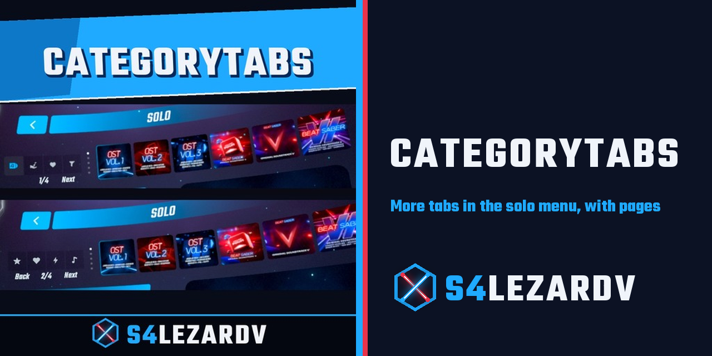
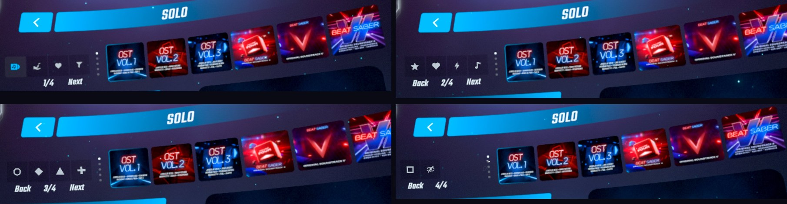
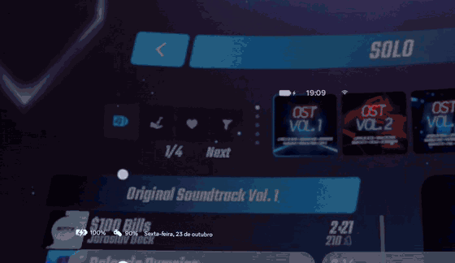

<p align="center">
  
</p>

<h1 align="center">CategoryTabs</h1>

<p align="center">
  <b>More tabs in the Beat Saber solo menu, with pages when they do not fit</b><br>
  A library mod for Quest, made for other mods to use
</p>

<p align="center">
  
  
  
</p>

<p align="center">
  
</p>

<p align="center">
  
</p>

## What it does

- Lets any mod add its own tab next to the ones the game has
- Adds **Back**, **Next** and a page counter when the tabs do not fit
- Picks a free category number for each tab, so mods do not clash
- Does nothing on its own, you only see it when another mod uses it

## Install

You do not need to look for it. A mod that needs CategoryTabs installs it for you when you add that mod with MBF.

To install it by hand, drop `CategoryTabs.qmod` from the [releases](../../releases) into MBF.

## Versions

- [Releases](../../releases) with the download of each version
- [Changelog](CHANGELOG.md) with what changed in each one

## Problems

Send `/sdcard/ModData/com.beatgames.beatsaber/logs2/CategoryTabs.log`.
Errors start with `CATEGORYTABS ERROR`.

## For mod authors

Copy `shared/CategoryTabsApi.hpp` into your mod and register the tab in `late_load`:

```cpp
CategoryTabsTab tab{
    "MyMod",
    "My Tooltip",
    icon.data(),
    icon.size(),
    [](void* navigation) { Show(static_cast<GlobalNamespace::LevelFilteringNavigationController*>(navigation)); },
    [] { Hide(); },
};
if (!CategoryTabsApi::Register(tab)) {
    Logger.warn("CategoryTabs is not installed");
}
```

| Field | What it is |
|---|---|
| `icon` | A PNG in memory, 128 px works well |
| `onSelected` | Runs when the player picks your tab, show your screen here |
| `onDeselected` | Runs when the player leaves your tab, can be null |

`Register` returns false when CategoryTabs is missing or the arguments are wrong, so your mod can carry on without it.

### A minimal screen

Your screen is a normal `HMUI::ViewController`, so you build it the way you like, here with BSML:

```cpp
DECLARE_CLASS_CODEGEN(MyMod, MyViewController, HMUI::ViewController) {
    DECLARE_OVERRIDE_METHOD_MATCH(void, DidActivate, &HMUI::ViewController::DidActivate, bool firstActivation, bool addedToHierarchy, bool screenSystemDisabling);
};

void MyMod::MyViewController::DidActivate(bool firstActivation, bool addedToHierarchy, bool screenSystemDisabling) {
    if (!firstActivation) {
        return;
    }
    gameObject->AddComponent<HMUI::Touchable*>();
    auto layout = BSML::Lite::CreateVerticalLayoutGroup(transform);
    BSML::Lite::CreateText(layout->transform, "Hello from my tab");
    BSML::Lite::CreateUIButton(layout->transform, "Click me", [] { Logger.info("clicked"); });
}

void Show(GlobalNamespace::LevelFilteringNavigationController* navigation) {
    static UnityW<MyMod::MyViewController> screen;
    if (!screen) {
        screen = BSML::Helpers::CreateViewController<MyMod::MyViewController*>();
    }
    navigation->ReplaceSecondViewController(screen.ptr());
}
```

Use `Show` as your `onSelected`. A full example with covers, switches and buttons is in [HidePacks](https://github.com/ThiagoAnd/Quest.HidePacks/blob/usa-categorytabs/src/Panel.cpp)

Add it as a dependency in `mod.template.json` so MBF installs it with your mod:

```json
{
  "id": "CategoryTabs",
  "versionRange": "^0.1.1",
  "downloadIfMissing": "https://github.com/ThiagoAnd/Quest.CategoryTabs/releases/download/v0.1.1/CategoryTabs.qmod"
}
```

## Used by

- [HidePacks](https://github.com/ThiagoAnd/Quest.HidePacks), hides official packs from the song list

## Credits

Made by **S4lezardv**

## License

GPL-3.0, see [LICENSE](LICENSE)
